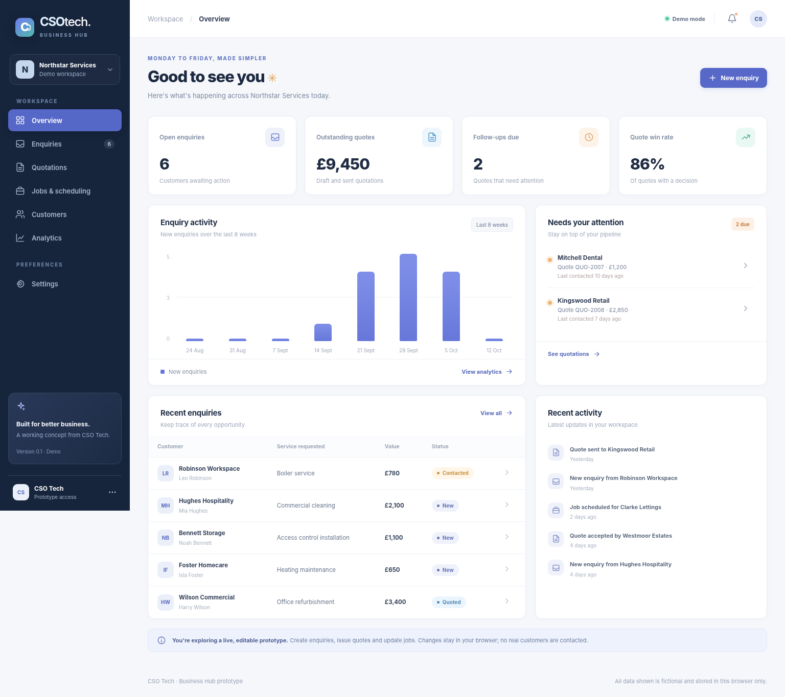

# CSO Business Hub — prototype v0.1

**A responsive, interactive business operations dashboard** for service companies. Built as a demonstration by CSO Tech (Chris, Seaton and Oliver).

> **Demo only.** All records are fictional. There is no authentication, backend, shared database, email integration, payment system or real scheduling service. Browser edits are saved **only to localStorage on that device**. Never put real customer information into this prototype. The default seeded `.example` email domains and `07700 900xxx` numbers are fictional.

## GitHub Pages demo

The demo address is https://rugfrog.github.io/cso-business-hub/ once GitHub Pages has been enabled and its deployment succeeds. No purchased domain is needed. Each browser keeps its own fictional demo records.

To enable it, open [Pages settings](https://github.com/Rugfrog/cso-business-hub/settings/pages), choose **Deploy from a branch**, select **main** and **/ (root)**, then click **Save**. Leave the custom domain field empty. Check **Actions → pages build and deployment** for successful publication before sharing the address.

## Screenshots



[Mobile dashboard preview](assets/preview-mobile.png)

## Features

- Responsive desktop, tablet and mobile layout with accessible navigation
- Overview dashboard with KPIs, enquiry activity, quote follow-up alerts, and recent activity
- Enquiries: create, search, filter, update status, and convert into quotations
- Quotations: create drafts, mark sent, follow up, copy a reminder message, accept or decline, duplicate, and print a sample quote
- Accepting a quotation automatically creates a scheduled job
- Jobs: Kanban-style status board, add jobs, reschedule, reassign, progress status
- Customers: automatically aggregates customer details and linked records
- Analytics: lead sources, conversion rate and pipelines
- CSV exports for enquiries, quotations and customers (with spreadsheet formula injection precautions)
- Settings for business name and follow-up interval, and one-click demo reset
- All mutations persist across browser reloads using localStorage

## Run it locally

The project uses **vanilla JavaScript ES modules + HTML + CSS**, no build tools or third-party dependencies. Optional checks run via the built-in Node.js test runner (`npm test`). This is intentional: zero configuration, easy to audit, and GitHub Pages compatible. It is not the recommended production architecture.

Run an HTTP server (don't double-click `index.html`, because ES modules are blocked by many browsers on `file://`):

```bash
python -m http.server 8080
```

Then visit **http://localhost:8080/**.

## Publish to GitHub Pages

The application is a buildless static site. Publish directly from the repository's root:

1. Open **Settings → Pages**.
2. Under **Build and deployment → Source**, choose **Deploy from a branch**.
3. Select branch **main**, folder **/ (root)**, then click **Save**.
4. Leave **Custom domain** empty.
5. Wait for **Actions → pages build and deployment** to finish successfully.

The root `.nojekyll` file tells GitHub to serve the existing HTML, JavaScript, CSS and assets directly. The **Check Business Hub** workflow runs JavaScript checks and seed-data tests separately; GitHub's built-in Pages workflow handles publication. Later changes pushed to `main` are published automatically.

A green **Check Business Hub** run confirms code checks, not that Pages is enabled. If the website returns 404, verify the selected source is `main / (root)` and the Pages deployment has succeeded.

## Product notes and test plan

See [product specification](docs/PRODUCT_SPEC.md) and [testing guide](docs/TESTING.md).

Run automated checks with `npm test` (requires Node 20+, no npm dependencies).

## Suggested production architecture

| Layer | Recommendation | Why |
| --- | --- | --- |
| Frontend | React + TypeScript + Vite | Component isolation, maintainability, reusable forms, type safety |
| Styling | Tailwind CSS + a carefully selected accessible component system | Fast to develop consistent mobile-first interfaces |
| API & database | Supabase (PostgreSQL) | Managed relational data, authentication and row-level security |
| Roles | Supabase Auth with enforced organisation/tenant permissions | Real multi-user accounts and tenant isolation |
| Automation | Server-side scheduled jobs / background worker | Timed quote reminders and event-driven workflows |
| Email | Resend or Postmark, with consent and audit logging | Real transactional quote/reminder delivery |
| Documents | Server-generated PDFs with branded quote templates | Consistent customer-facing quotations |
| Hosting | Vercel or Netlify for frontend; hosted backend and data | Managed deployment and staging environments |
| Monitoring | Sentry + audit logs + database backups | Reliability and accountability |

For a business with Microsoft 365 licensing, Power Apps, Power Automate, Dataverse/SharePoint and Power BI may be a suitable **alternative** to a custom web app, depending on per-user costs and integration requirements.

## Before taking paying customers

- Authenticate users and implement strict per-company multi-tenancy with database row-level security.
- Agree lawful basis, UK GDPR privacy notices, data retention/deletion, DPAs and hosting location.
- Validate forms server-side; introduce authorisation, rate-limiting, secrets management and audit trails.
- Add job calendar, quote items/VAT logic, branded PDF, email delivery, follow-up rules, team roles, activity history, backups and automated tests.
- Verify that any real follow-up outreach complies with applicable direct-marketing rules.
- Define scope, support, SLAs and ownership in contracts.

## Suggested backlog

1. Customer discovery with 5–10 local service businesses; find the most requested workflow.
2. Real database, login and per-organisation workspaces.
3. Detailed quote builder with line items, VAT and PDF/email delivery.
4. Scheduling calendar, assignment, reminders and mobile technician view.
5. Enquiry capture form embedded in each business's existing website.
6. Two-way email and Outlook/Microsoft 365 integration.
7. Client portal with quote acceptance and approval records.
8. Automated regression, security and accessibility testing before launch.

## IP and licensing

No license has been granted by default. Before putting the code into production or bringing in collaborators, agree IP ownership among the founders and select a repository license deliberately.
